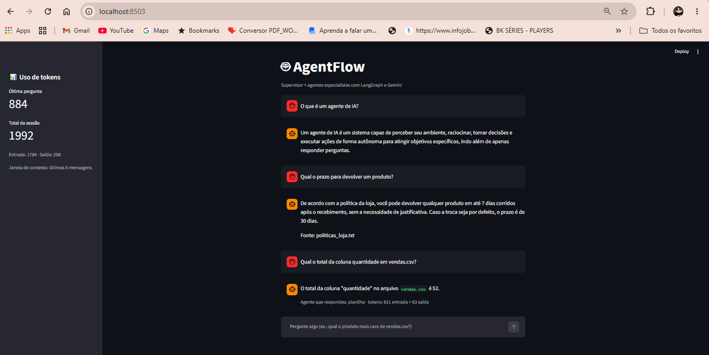
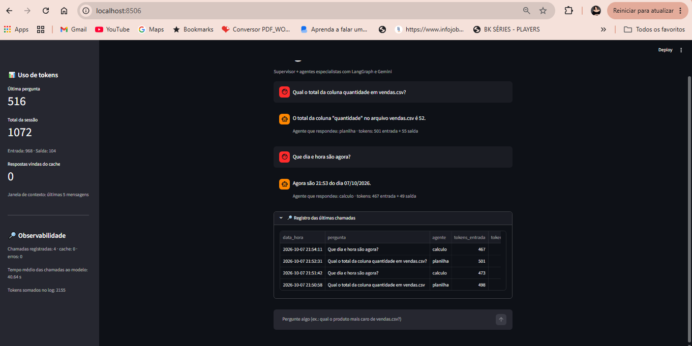
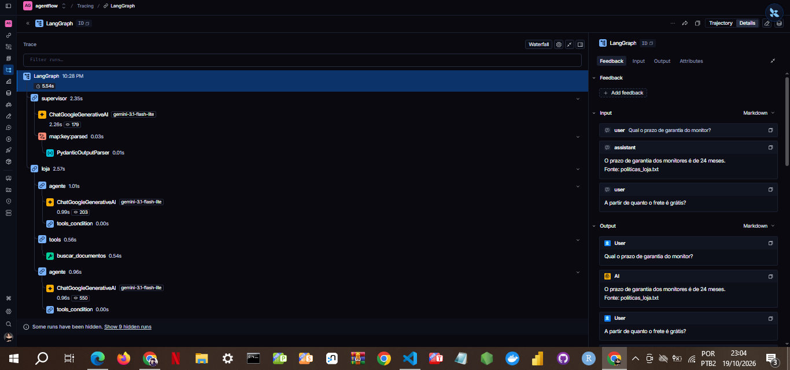

# AgentFlow

Plataforma de automação com agentes de IA, construída com **LangGraph** e **Gemini**.

O projeto evolui por etapas: de um grafo simples até um sistema multiagente que usa ferramentas, lê planilhas, consulta documentos com RAG, lembra da conversa, controla o uso de tokens, guarda respostas em cache, registra cada chamada (em um log local e no LangSmith), é validado por testes automáticos e tem interface web.



## O que já funciona

| Arquivo | O que faz |
|---|---|
| `grafo_basico.py` | Primeiro grafo do LangGraph, conectado ao Gemini |
| `agente_ferramentas.py` | Agente que decide sozinho entre responder direto ou usar ferramentas (soma e data/hora) |
| `agente_planilha.py` | Agente que lê planilhas CSV e responde perguntas sobre os dados |
| `agente_memoria.py` | Agente que lembra da conversa (memória por `thread_id`) |
| `agente_rag.py` | Agente RAG: busca em documentos e responde citando a fonte |
| `agente_multiagente.py` | Supervisor que delega a pergunta para 4 agentes especialistas e contabiliza tokens |
| `cache_respostas.py` | Cache de respostas em dois níveis: exato e semântico (perguntas parecidas). Resposta do cache custa 0 tokens de chat |
| `observabilidade.py` | Registro de cada chamada (agente, tokens, tempo, cache, erro) em arquivo de log |
| `app_web.py` | Interface web de chat (Streamlit) com painéis de tokens, cache e observabilidade |
| `avaliar.py` | Avaliação automática: roda perguntas de teste e gera um relatório |
| `calibrar_cache.py` | Mede a similaridade de pares de perguntas para escolher o limite do cache semântico |

## Como o agente funciona

```
START -> agente -> (precisa de ferramenta?) -> ferramentas -> agente -> resposta
```

O modelo analisa a pergunta e **decide** se responde direto ou chama uma ferramenta. Depois de executar, ele volta ao agente, que usa o resultado para escrever a resposta final.

## Arquitetura multiagente

```
                 +--> planilha (ler_planilha, somar_coluna)
                 +--> calculo  (somar, data_e_hora_atual)
START -> supervisor
                 +--> loja     (buscar_documentos, RAG)
                 +--> geral    (sem ferramentas)
```

O **supervisor** lê a pergunta e escolhe qual agente especialista vai respondê-la. Cada especialista tem as suas próprias ferramentas e instruções. A interface web mostra, abaixo de cada resposta, qual agente respondeu.

## RAG sobre documentos

```
documentos (.txt) -> pedaços (chunks) -> embeddings -> índice vetorial
pergunta -> busca por similaridade -> trechos relevantes -> agente responde com a fonte
```

- Os documentos ficam na pasta `base_conhecimento/`.
- Os embeddings são gerados com `gemini-embedding-001`.
- O agente é instruído a responder **somente** com base nos trechos encontrados, a citar o arquivo de origem e a admitir quando não encontra a informação.

## Controle de tokens

- **Medição:** cada pergunta soma os tokens de entrada e de saída de todas as chamadas ao modelo (supervisor e agente especialista). A interface mostra o valor da última pergunta e o total da sessão.
- **Janela deslizante:** o modelo recebe apenas as últimas 5 mensagens da conversa, em vez do histórico inteiro, para que o custo não cresça a cada pergunta.

Exemplo de medição:

```
Pergunta: Qual o prazo de garantia do monitor?
  [supervisor] escolheu o agente: loja
Tokens: 695 de entrada + 60 de saída

Pergunta: Qual o total da coluna quantidade em vendas.csv?
  [supervisor] escolheu o agente: planilha
Tokens: 464 de entrada + 63 de saída
```

A pergunta que usa RAG gasta mais tokens de entrada, porque os trechos recuperados dos documentos entram no prompt.

## Cache de respostas

Antes de chamar o modelo, a interface procura a pergunta em **dois caches**, nesta ordem:

1. **Cache exato:** a mesma pergunta (maiúsculas e espaços não importam) no mesmo contexto.
2. **Cache semântico:** uma pergunta escrita de outro jeito, mas com o mesmo significado. A pergunta vira um embedding (`gemini-embedding-001`) e é comparada, por similaridade de cosseno, com as perguntas já respondidas.

Nos dois casos a resposta volta na hora, **sem gastar tokens de chat** (o cache semântico gasta só uma chamada de embedding, bem mais barata). A legenda da resposta mostra qual cache foi usado e, no semântico, a similaridade.

Exemplo real: *"Quanto tempo de garantia tem o monitor?"* e *"Qual o prazo de garantia do monitor?"* tiveram similaridade de **0,992**, e a segunda resposta veio do cache semântico.

- A chave considera a pergunta **e as mensagens anteriores** da janela de contexto, e o cache semântico só compara perguntas no **mesmo contexto**. Assim, uma pergunta como "E qual é o mais barato?" nunca recebe uma resposta guardada de outra conversa.
- As respostas ficam em `cache/respostas.json` e `cache/semantico.json`, que não são enviados ao GitHub.
- A versão dos documentos de `base_conhecimento/` faz parte da chave: se um documento mudar, o cache antigo é ignorado sozinho.
- Se a chamada de embedding falhar, a pergunta segue normalmente para o modelo.
- A avaliação automática chama o sistema direto, sem cache, para testar o modelo de verdade.

### Calibração do limite

O script `calibrar_cache.py` mede a similaridade de pares de perguntas que **deveriam** e que **não deveriam** ser tratadas como iguais:

- pares iguais: nota mínima de **0,929**
- pares diferentes: nota máxima de **0,912**

O par mais perigoso foi *"produto mais caro"* contra *"produto mais barato"* (0,912): o modelo de embeddings acha parecidas perguntas sobre o mesmo assunto, mesmo com respostas opostas. Por isso o limite escolhido foi **0,95**, uma margem de segurança. No teste, as duas perguntas foram ao modelo e responderam corretamente (Monitor, R$ 899,00, e Mouse, R$ 45,50).

### Limitações do cache semântico

- O limite foi escolhido com apenas 8 pares de perguntas, um conjunto pequeno.
- Com 0,95, uma pergunta igual (a da devolução, 0,929) não reaproveita o cache. Foi uma escolha consciente: é melhor gastar tokens do que devolver uma resposta errada.
- Como só compara perguntas no mesmo contexto, ele ajuda mais no começo das conversas.

## Observabilidade

Cada pergunta respondida pela interface gera uma linha no arquivo `logs/chamadas.jsonl`, com:

- data e hora
- pergunta
- agente que respondeu
- tokens de entrada e de saída
- tempo de resposta, em segundos
- se a resposta veio do cache e de qual tipo (exato ou semântico)
- se houve erro

A interface lê esse arquivo e mostra, no painel lateral, o número de chamadas, quantas vieram do cache, quantos erros ocorreram, o tempo médio das chamadas ao modelo e o total de tokens. Uma tabela com as últimas chamadas fica disponível na página.



Isso permite investigar, por exemplo, qual pergunta foi lenta, qual agente foi escolhido e quanto o cache economizou. O arquivo de log não é enviado ao GitHub, porque contém as perguntas feitas ao sistema.

## Rastreamento com LangSmith

Além do log local, cada pergunta gera um **traço** no [LangSmith](https://smith.langchain.com), com a árvore completa da execução: supervisor, agente especialista, chamadas ao modelo e ferramentas, cada uma com o seu tempo.



O traço mostra, por exemplo, que em uma pergunta sobre a loja (5,54 s no total) o supervisor levou 2,35 s, cerca de 42% do tempo, só para escolher o agente, porque essa escolha é uma chamada extra ao modelo. Os 932 tokens contados pelo LangSmith batem com os mostrados na interface.

Para ativar, crie uma conta em smith.langchain.com, gere uma chave de API e acrescente ao `.env` (os nomes das variáveis estão no `.env.example`):

```
LANGSMITH_TRACING=true
LANGSMITH_ENDPOINT=https://api.smith.langchain.com
LANGSMITH_API_KEY=sua_chave
LANGSMITH_PROJECT=agentflow
```

Não é preciso mudar o código: o LangGraph envia os traços sozinho. Se o rastreamento não for configurado, o projeto funciona normalmente, só sem o painel do LangSmith.

## Avaliação automática

O script `avaliar.py` roda 13 perguntas de teste e confere três coisas em cada uma:

1. O supervisor escolheu o **agente esperado**?
2. A resposta contém a **informação esperada** (palavras-chave)?
3. Um **juiz por significado** concorda? O próprio Gemini (temperatura 0) compara a resposta dada com a resposta esperada e explica a decisão em uma frase.

O resultado é salvo em [`docs/avaliacao.md`](docs/avaliacao.md), com uma coluna para cada método, as divergências entre eles e o motivo dado pelo juiz em cada caso.

**Resultado atual: 13 de 13 perguntas corretas**, sem divergência entre palavras-chave e juiz (7868 tokens de entrada + 984 de saída no total).

Os casos cobrem: perguntas escritas de outro jeito, erros de digitação, perguntas fora do escopo (o agente deve dizer que não encontrou, como em *geladeira* e *micro-ondas*), pergunta geral sem relação com a loja e pergunta com duas informações na mesma frase.

### O que a avaliação encontrou

Na primeira execução, com 6 casos, o resultado foi **5 de 6**. A pergunta *"Vocês vendem geladeira?"* foi enviada pelo supervisor ao agente **geral**, que não consulta os documentos, em vez do agente **loja**. A causa era a instrução do supervisor, que descrevia a loja apenas como "políticas" e não incluía perguntas sobre os produtos vendidos. Depois de ajustar a instrução, a avaliação passou de 5 para 6 acertos.

### Limitações

- São 13 casos, ainda um conjunto pequeno, e todos são cenários esperados: não há casos adversariais (por exemplo, tentativas de fazer o agente ignorar as instruções).
- O juiz é o mesmo modelo que gera as respostas, e por isso pode favorecer as próprias respostas. Os motivos do juiz ficam no relatório para conferência manual.
- A checagem por palavras-chave aceita a resposta se **qualquer um** dos termos aparecer. Na pergunta com duas informações, ela passaria com apenas uma delas, e é o juiz que cobre essa lacuna.

## Exemplos de execução

### Agente com ferramentas

```
Pergunta: Qual o total da coluna quantidade em vendas.csv?
  -> Ferramenta usada: somar_coluna {'nome_arquivo': 'vendas.csv', 'coluna': 'quantidade'}
Resposta: O total da coluna "quantidade" no arquivo vendas.csv é 52.
```

### Agente com memória

```
Pergunta: Qual é o produto mais caro de vendas.csv?
Resposta: O produto mais caro é o Monitor, com um preço de 899,00.

Pergunta: E qual é o mais barato?
Resposta: O produto mais barato é o Mouse, com um preço de 45,50.
```

Na segunda pergunta o agente não recebeu o nome da planilha: ele entendeu pelo contexto da conversa.

### RAG

```
Pergunta: Vocês vendem geladeira?
  [supervisor] escolheu o agente: loja
  -> Ferramenta usada: buscar_documentos {'pergunta': 'Vocês vendem geladeira?'}
Resposta: Não encontrei informações sobre a venda de geladeiras nos documentos da Techponto.
```

O agente admite que não encontrou a informação, em vez de inventar uma resposta.

## Tecnologias

- Python 3.10
- LangGraph e LangChain
- Gemini (Google AI Studio): modelo de chat e embeddings
- Streamlit
- NumPy (similaridade do cache semântico)
- LangSmith (rastreamento, opcional)

## Como rodar

1. Clone o repositório:
```bash
git clone https://github.com/kallymeire/agentflow.git
cd agentflow
```

2. Crie e ative o ambiente virtual (Windows):
```bash
python -m venv .venv
.venv\Scripts\Activate.ps1
```

3. Instale as dependências:
```bash
pip install -r requirements.txt
```

4. Crie uma chave em [aistudio.google.com](https://aistudio.google.com), copie o arquivo `.env.example` para `.env` e cole a chave nele. O arquivo `.env` nunca deve ser enviado ao GitHub. As variáveis do LangSmith são opcionais.

5. Rode a interface web:
```bash
streamlit run src\agentflow\app_web.py
```

Ou rode a avaliação automática (leva alguns minutos, por causa das pausas entre as perguntas):
```bash
python src\agentflow\avaliar.py
```

> O plano gratuito do Gemini tem limite de chamadas por minuto e por dia. Se aparecer o erro 429, aguarde ou troque a variável `MODELO` no código.

## Estrutura

```
agentflow/
├── src/agentflow/       # grafos, agentes, cache, observabilidade, interface web e avaliação
├── base_conhecimento/   # documentos usados pelo RAG
├── dados/               # planilhas de exemplo
├── docs/                # imagens e relatório de avaliação
├── requirements.txt
└── .env.example
```

## Checklist do projeto

- [x] Memória de conversa
- [x] Sistema multiagente com supervisor
- [x] Interface web
- [x] RAG sobre documentos
- [x] RAG integrado ao supervisor e à interface web
- [x] Controle de uso de tokens e janela de contexto
- [x] Avaliação automática com perguntas de teste
- [x] Cache de respostas repetidas
- [x] Observabilidade (registro das chamadas)
- [x] Rastreamento com LangSmith
- [x] Mais casos de teste e avaliação por significado
- [x] Cache semântico

## Ideias para evoluir

- [ ] Casos de teste adversariais e um juiz com modelo diferente do que responde
- [ ] Publicar a interface online

## Autora

Kallymeire Coelho, [GitHub](https://github.com/kallymeire) · [LinkedIn](https://www.linkedin.com/in/kallymeire-coelho-212746263)